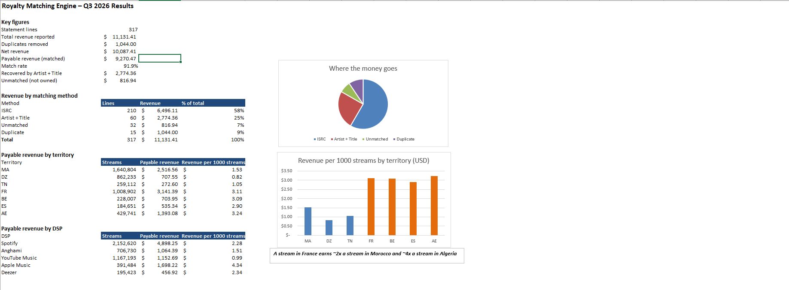

# 🔎 Royalty Matching Engine – MENA

> **[Try the Interactive Demo →](https://prudent229.github.io/royalty-matching.html)**

An Excel-based engine that matches raw DSP statements to a label catalogue and measures how much streaming revenue is lost when matching relies on ISRC codes alone.



## 🎯 The Problem

DSP statements rarely arrive clean. ISRCs come with dashes, lowercase letters or typos, or are missing entirely. Artist names and titles appear in Latin script, Darija transliteration or Arabic script (*Khouya*, *Khoya*, *خويا*). Every line that cannot be matched to the catalogue sends revenue into a "black box" instead of to the rights holder.

This is particularly acute in North Africa, where independent releases often lack clean metadata and the same name can be written in several scripts.

## 📊 Key Results (Q3 2026, simulated)

| Metric | Result |
|---|---|
| Statement lines processed | **317** (5 DSPs, 7 territories) |
| Net revenue (after duplicates) | **$10,087.41** |
| Match rate with ISRC only | **64.4%** |
| Match rate with the full engine | **91.9%** |
| Revenue recovered by artist + title matching | **$2,774.36** |
| Duplicate payments avoided | **$1,044.00** |

**Diaspora effect:** a stream in France earns **~2x** a stream in Morocco and **~4x** a stream in Algeria ($3.11 vs. $1.53 vs. $0.82 per 1,000 streams).

## ⚙️ How the Engine Works

Each statement line goes through three steps, all built with standard Excel formulas:

**1. ISRC matching**
The reported ISRC is cleaned (dashes and spaces removed, uppercase), then looked up in the catalogue.
```
=UPPER(SUBSTITUTE(SUBSTITUTE(E2,"-","")," ",""))
=IFERROR(INDEX(Catalogue!$A:$A,MATCH(J2,Catalogue!$B:$B,0)),"")
```

**2. Artist + title matching (fallback)**
When the ISRC is missing or wrong, the artist and title are translated to their canonical names through an alias table (Latin, transliteration and Arabic variants), then matched on an `Artist|Title` key.
```
=IFERROR(INDEX(Alias_Table!$C:$C,MATCH(LOWER(TRIM(G2)),Alias_Table!$B:$B,0)),"")
=IFERROR(INDEX(Catalogue!$A:$A,MATCH(L2&"|"&M2,Catalogue!$I:$I,0)),"")
```

**3. Duplicate detection**
A fingerprint of each line is built, and a running count flags any line already reported earlier, so it is not paid twice.
```
=IF(COUNTIF($Q$2:Q2,Q2)>1,"Yes","No")
```

The dashboard then aggregates results with `SUMIFS` and `COUNTIFS` by matching method, territory and DSP.

## 📁 Workbook Structure

| Sheet | Content |
|---|---|
| `Read_Me` | Project description and the six data problems hidden in the statements |
| `Dashboard` | Key figures, revenue by method, territory and DSP, charts |
| `Catalogue` | 38 tracks of the fictional label (ISRC, ISWC, writers, publisher) |
| `DSP_Statements` | 317 statement lines and every matching formula column |
| `Alias_Table` | 102 alternative spellings of artist names and titles |
| `Answer_Key` | Expected result for each line, used to validate the engine |

## 🛠️ How to Use

1. Download [`Royalty_Matching_Engine.xlsx`](Royalty_Matching_Engine.xlsx)
2. Open it in Microsoft Excel (2019 or later)
3. Start with the `Dashboard` sheet, then explore the formula columns in `DSP_Statements`
4. Edit a reported ISRC, title or artist to see the matching update

## 🎓 Skills Demonstrated

- Royalty operations: ISRC/ISWC metadata, catalogue matching, unclaimed revenue
- Excel modelling: INDEX/MATCH, SUMIFS, COUNTIFS, nested IF, text cleaning, running counts
- Data quality: normalisation, alias management, duplicate detection, validation against an answer key
- Market insight: territorial payout differences and the value of diaspora audiences

## ⚠️ Disclaimer

All data is fictional. **Atlas Sound Records**, its artists and its tracks do not exist. Stream counts and revenues are simulated; per-stream levels vary by DSP and territory for illustration only.

> 🛠️ *Built with AI assistance (data generation, web page and documentation), under my direction and review. The Excel matching model was built by me, step by step.*

## 👤 About the Author

**Prudent Honliasso**
Music Data & Financial Analyst | AI & Royalties
5+ years of experience in music rights administration and royalty calculations · Master's in Accounting, Control & Audit (CCA)

- 💼 [LinkedIn](https://www.linkedin.com/in/prudent-honliasso/)
- 🌐 [Portfolio](https://prudent229.github.io)

## 🔗 Related Projects

- [DSP Payment Simulator – MENA](https://github.com/Prudent229/dsp-payment-simulator-mena)
- [Music Royalties & AI Impact Simulator](https://github.com/Prudent229/music-royalties-ai)
